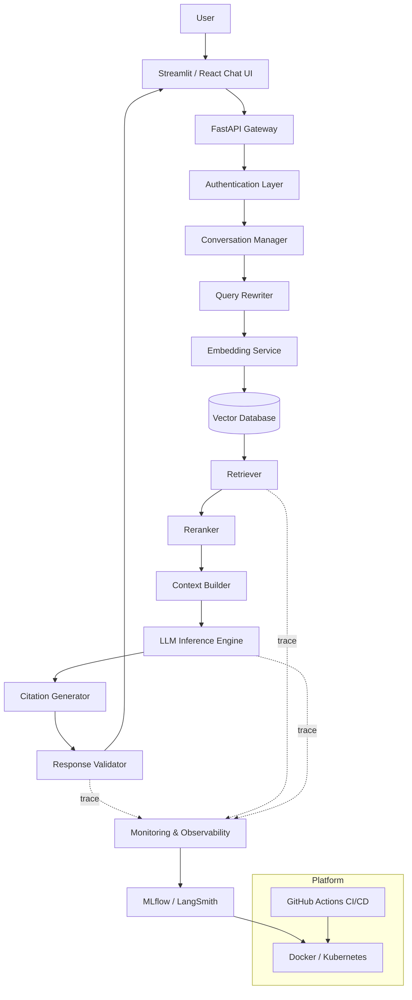
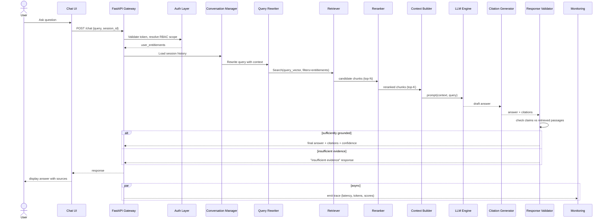
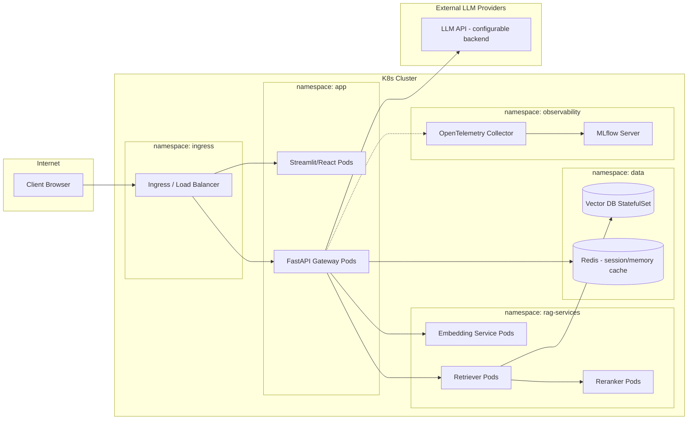
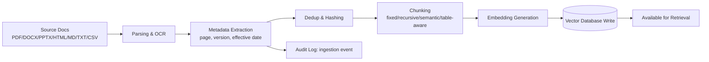
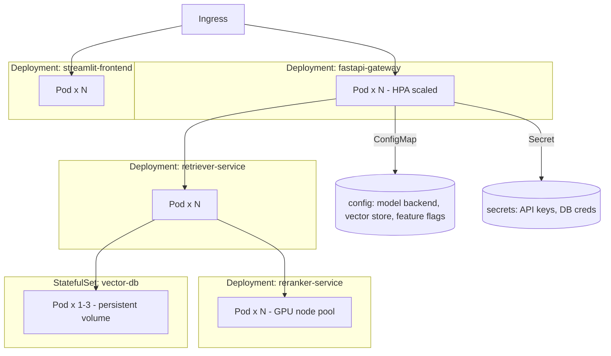

# Milestone 1 — Enterprise System Architecture

## 1. Architectural Principles

1. **Every stage is swappable via config, not code.** LLM backend, embedding model, vector store, and reranker are all selected through Hydra/Pydantic-settings config, so a deployment can move from FAISS to Qdrant or GPT-family to Claude without touching pipeline logic.
2. **Retrieval and generation are decoupled and independently observable.** The Retriever and the LLM Inference Engine are separate services in the trace graph so retrieval quality can be evaluated without conflating it with generation quality.
3. **Grounding is enforced, not requested.** The Response Validator is a real pipeline stage (not just a system-prompt instruction) that checks generated claims against retrieved passages.
4. **Security is enforced at the retrieval boundary.** RBAC and namespace filtering happen in the Retriever, so no downstream component ever sees a document the requesting user isn't entitled to.
5. **Everything emits structured traces.** Every request carries a trace ID from the API Gateway through to the Monitoring layer, so a single query's full path (rewrite → retrieve → rerank → generate → validate) is reconstructable end-to-end.

## 2. High-Level Component Map

| Layer | Component | Responsibility |
|---|---|---|
| Client | Streamlit / React Chat UI | Chat interface, document upload, source viewer, admin dashboards |
| Edge | FastAPI Gateway | Request routing, request/response schemas, rate limiting |
| Security | Authentication Layer | Token validation, RBAC entitlement resolution |
| Orchestration | Conversation Manager | Session state, conversation history, memory compression |
| Orchestration | Query Rewriter | Resolves coreference/context from history into a self-contained query; query expansion |
| Retrieval | Embedding Service | Encodes queries (and documents, at ingestion time) into vectors |
| Retrieval | Vector Database | Stores embeddings + metadata; supports filtered ANN search |
| Retrieval | Retriever | Dense + sparse hybrid retrieval, metadata/RBAC filtering |
| Retrieval | Reranker | Cross-encoder rescoring of candidate chunks |
| Generation | Context Builder | Assembles the final prompt context window within token budget |
| Generation | LLM Inference Engine | Backend-agnostic call to the configured LLM |
| Generation | Citation Generator | Maps generated claims back to source chunk IDs/pages |
| Trust | Response Validator | Checks faithfulness; triggers "insufficient evidence" fallback |
| Ops | Monitoring & Observability | Structured logs, metrics, traces |
| Ops | MLflow / LangSmith | Experiment tracking, prompt/version tracking, trace inspection |
| Platform | Docker / Kubernetes | Containerization and orchestration |
| Platform | GitHub Actions CI/CD | Test, lint, build, deploy pipeline |

## 3. System Architecture Diagram

## 4. Sequence Diagram — Single Query Lifecycle

## 5. Deployment Topology

## 6. Data Flow Diagram — Ingestion Path

## 7. Kubernetes Deployment Diagram (conceptual — manifests delivered in Milestone 12)

## 8. Key Design Decisions

| Decision | Rationale | Trade-off Accepted |
|---|---|---|
| Hybrid dense + sparse retrieval, not dense-only | Legal/financial text has exact-term queries (clause numbers, defined terms) that dense embeddings alone under-serve | Added complexity of maintaining a BM25 index alongside the vector index |
| Reranking stage is mandatory, not optional | Cross-encoder reranking meaningfully improves precision on the top few results, which is what the LLM actually sees | Added latency (~50–150ms) per query |
| Response Validator as a real pipeline stage | A system-prompt instruction alone is not a reliable hallucination control | Adds one more LLM/verifier call per query, increasing cost and latency |
| Multi-backend LLM abstraction from day one | Enterprise buyers frequently mandate a specific vendor or on-prem model; hard-coding one vendor blocks adoption | More upfront engineering than a single-provider integration |
| Namespace-isolated vector collections per domain | Cross-domain term collisions (e.g., "coverage") and RBAC boundaries are cleaner with isolation than one global index with heavy metadata filtering | Slightly more operational overhead (N collections instead of 1) |

## 9. Non-Functional Requirements (initial targets, refined after benchmarking in later milestones)

- **Latency:** p95 end-to-end query latency ≤ 4s for a standard lookup query (excluding first-token streaming).
- **Availability:** stateless services (gateway, retriever, reranker) horizontally scalable and individually restart-safe.
- **Scalability:** ingestion pipeline supports incremental batch loads without full reindexing.
- **Observability:** 100% of requests traced end-to-end with a correlation ID.
- **Auditability:** every query + retrieved chunk set + answer retained per the audit-logging policy in `01_business_understanding.md`.

---
*This closes Milestone 1 (Business Understanding & Enterprise Architecture). Milestone 2 will scaffold the actual repository structure shown in the spec.*
